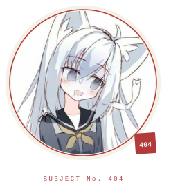

  <picture>
    <source media="(prefers-color-scheme: dark)" srcset="assets/hero-dark.svg">
    
  </picture>

  <a href="https://for404cat.github.io/for404cat/">FULL PROFILE / PAGES</a>

Systems engineer, mostly Rust. I work on the boundary between hardware,
the kernel, and things that were never meant to be automated.

Currently building **MixumART**, a Rust runtime for AI agents.

English for work. 中文用來吐槽。

`GENDER` — ATTACK HELICOPTER (GROUNDED). 性別武裝直升機，但目前停飛——GitHub 只讓我選「其他」。

 

---

`NOW` — building **MixumART** · soldering something with too many wires · obeying `false`

I solder MCUs, sensors, and other things that were never meant to be
connected to a computer. Not systematic. Not certified. Still running.

不是電子工程師，只是手比較癢。

---

### bill of materials / 部品表

`TECH STACK / REV. 2026.10`

| REF | PART | NOTES |
| --- | --- | --- |
| `U1` | **Rust** | primary language |
| `U2` | **C** | when Rust is too polite |
| `U3` | **Python** | glue and scripts |
| `U4` | **TypeScript** | when it has to run in a browser |
| `R1` | **Linux** | host environment |
| `R2` | **Docker** | containment |
| `C1` | **STM32 / ESP32** | small things that blink |
| `C2` | **KiCad / PCB** | custom boards |
| `TP1` | **Oscilloscope** | trust issues |

缺料是常態。

---

404: cat not found. 偵探形態是外包的，本體見上。
